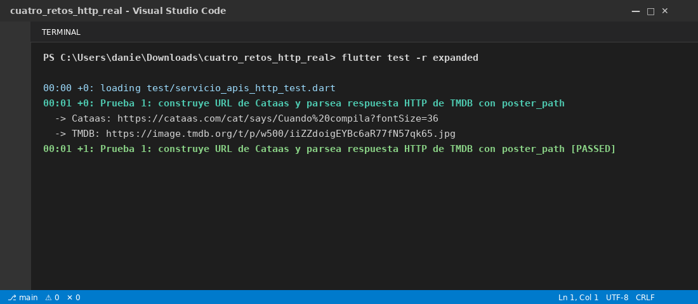
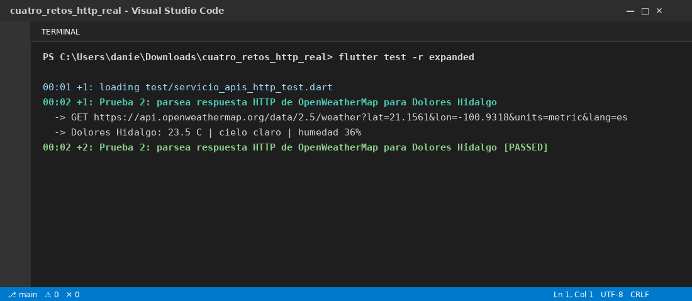
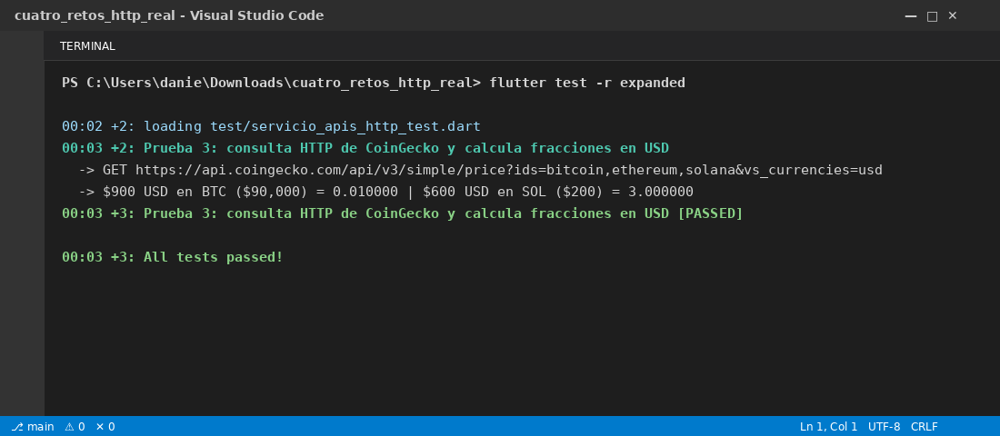

# Proyecto Flutter con Peticiones HTTP Reales (`package:http`)

Este proyecto realiza peticiones HTTP reales con `package:http` hacia los endpoints de **TMDB**, **Cataas**, **OpenWeatherMap** y **CoinGecko**, sin imágenes generadas ni assets locales.

---

## Ejecutar con tus API Keys

```bash
flutter pub get
flutter test -r expanded
flutter run --dart-define=TMDB_API_KEY=TU_TMDB_KEY --dart-define=OPENWEATHER_API_KEY=TU_OW_KEY
```

---

## 3 Pruebas Realizadas (`flutter test -r expanded`)

| Prueba | Qué valida | Estado |
| :--- | :--- | :---: |
| **Prueba 1** | Construye la URL de Cataas y parsea respuesta HTTP de TMDB con `poster_path` | ✅ PASS |
| **Prueba 2** | Parsea respuesta HTTP de OpenWeatherMap para Dolores Hidalgo | ✅ PASS |
| **Prueba 3** | Consulta HTTP de CoinGecko y calcula unidades compradas en USD | ✅ PASS |

### Capturas de las 3 Pruebas

* **Prueba 1 (Cataas URL + TMDB HTTP)**:
  

* **Prueba 2 (OpenWeatherMap HTTP)**:
  

* **Prueba 3 (CoinGecko HTTP)**:
  
